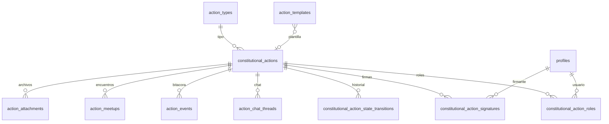

# Modelo de dominio

## Núcleo

La **acción constitucional** (`constitutional_actions`) es el agregado raíz.

## Tablas principales

| Tabla | Descripción |
|-------|-------------|
| `action_types` | Catálogo 6 tipos judiciales |
| `constitutional_actions` | Acción: contenido, estado, firmas, radicación |
| `constitutional_action_roles` | CREADOR, LIDER, CO_LIDER, APOYO |
| `constitutional_action_signatures` | Firma con snapshot legal |
| `constitutional_action_state_transitions` | Auditoría de cambios de estado |
| `action_templates` | Plantillas ADMIN |
| `action_chat_*`, `action_events`, `action_meetups`, `action_attachments` | Comunidad y trazabilidad |
| `profiles` | + identidad firmable |

## Tipos TypeScript

`src/core/entities/ConstitutionalAction.ts`, `ActionType.ts`, etc.

## Referencias

- [Estados](estados-accion.md)
- [Esquema](../05-base-de-datos/esquema.md)
